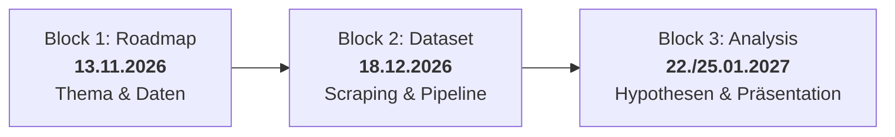

# Kölner Mietpreise und Lebensqualität: Eine empirische Analyse von Veedel-Strukturen, Infrastruktur und Mietpreisentwicklung

> **Modul:** DIS 3.3 Data Integration • Wintersemester 2026/27  
> **Hochschule:** TH Köln – Technische Hochschule Köln 
> **Dozent:** Prof. Dr. Timo Breuer  
> **Team:** data-integration-HMDT  
> **Status:** Milestone 1: Roadmap (Abgabe: 13.11.2026)

---

## 1. Projektübersicht & Motivation

Der Wohnungsmarkt in Köln steht wie in vielen deutschen Großstädten unter erheblichem Druck. Bei der Wohnungssuche und der Bewertung von Mietpreisen spielen neben der reinen Wohnfläche vor allem die Lage und die Qualität des unmittelbaren Wohnumfelds („Veedel“) eine entscheidende Rolle.

Doch welche Faktoren bestimmen das Mietpreisniveau in den verschiedenen Kölner Stadtteilen tatsächlich am stärksten? Oft wird vermutet, dass vor allem die Rheinnähe oder die historische Einteilung in links- und rechtsrheinische Stadtteile den Preis diktieren. Unklar ist jedoch, welchen quantitativen Einfluss lokale Infrastrukturfaktoren – wie die Nähe zu öffentlichen Grünflächen und Parks, die Dichte an KVB-Haltestellen oder soziale Stadtteilmerkmale (z. B. Studierendenanteil, Altersstruktur) – im Vergleich zur Makrolage haben.

Ziel dieses Projekts ist es, offene Verwaltungs- und Geodaten der Stadt Köln mit gescrapten aktuellen Mietangebots- und Marktdaten zusammenzuführen. Durch den Aufbau einer reproduzierbaren Data-Pipeline wollen wir die Determinanten der Kölner Mietpreise empirisch analysieren und untersuchen, wie stark Lebensqualität und Infrastruktur die Wohnkosten in den Veedeln prägen.

---

## 2. Forschungsfragen

Zur Beantwortung unserer Problemstellung untersuchen wir drei zentrale Forschungsfragen:

* **Forschungsfrage 1 (Grünflächen & Naherholung):**  
  *Besteht ein statistisch signifikanter positiver Zusammenhang zwischen dem Anteil an öffentlichen Grünflächen (bzw. der mittleren Distanz zu Parkanlagen) eines Kölner Stadtteils und dem durchschnittlichen Quadratmetermietpreis?*
* **Forschungsfrage 2 (ÖPNV-Infrastruktur & Rheinufer-Effekt):**  
  *In welchem Maße lässt sich die Varianz der Stadtteilmieten durch die Dichte und Anbindung des KVB-Netzes (Haltestellendichte) erklären, und bleibt das Preisgefälle zwischen links- und rechtsrheinischen Veedeln auch nach Kontrolle der Verkehrsanbindung signifikant bestehen?*
* **Forschungsfrage 3 (Demografie & Sozialstruktur):**  
  *Welcher Zusammenhang besteht zwischen soziokulturellen Stadtteilmerkmalen (z. B. Anteil junger Erwachsener / Studierender, Haushaltsgröße) und den Mietpreisen im Vergleich zur rein baulichen und verkehrlichen Infrastruktur?*

---

## 3. Datenquellen & Lizenzen

Für die Analyse integrieren wir offene Verwaltungs- und Geodaten mit aktuellen Webdaten:

| Quelle | Inhalt / Merkmale | Typ | Lizenz | Geplante Verwendung |
| :--- | :--- | :--- | :--- | :--- |
| **Offene Daten Köln / GovData** (`offenedaten-koeln.de`) | Kölner Stadtteilprofile (Fläche, Demografie, Altersgruppen, Einwohnerdichte nach Stadtteil) | Open Data (CSV / JSON) | `dl-de/zero-2.0` (Datenlizenz Deutschland – Zero – Version 2.0) | Soziodemografische Basisdaten für alle 86 Kölner Stadtteile |
| **Geoportal Stadt Köln / Open Data** (`offenedaten-koeln.de`) | Geodaten zu öffentlichen Grünflächen, Parks und KVB-Haltestellennetz | Open Data (GeoJSON / Shapefile) | `dl-de/zero-2.0` | Berechnung von Infrastruktur-Dichten und Distanzen zu Parks/ÖPNV |
| **Online-Immobilienportale & Mietspiegel** (z. B. WG-Gesucht / Immowelt) | Aggregierte Mietpreisangebote (€/m² Kalt- und Warmmiete, Wohnungsgrößen nach Stadtteil) | Web Scraping / HTML | Fair Use / Bildungs- & Forschungszweck (Einhaltung `robots.txt`, Caching & Rate Limiting) | Ermittlung des aktuellen Mietpreisniveaus je Veedel |

> [!NOTE]
> Alle Daten werden im Einklang mit den **FAIR-Prinzipien** (*Findable, Accessible, Interoperable, Reusable*) verarbeitet. Bereinigungslogik, Geodaten-Zuordnungen und Quellenherkunft werden im Repository lückenlos dokumentiert.

---

## 4. Projekt-Roadmap

Unser Zeitplan richtet sich nach den Meilensteinen des Kurses:



### Meilenstein 1: Roadmap (Fällig: 13.11.2026) – *Abgeschlossen*
- [x] Teambildung und Einrichtung des gemeinsamen GitHub-Repositories
- [x] Themenfindung (Kölner Mietpreise & Veedel-Infrastruktur) und Definition dreier quantitativer Forschungsfragen
- [x] Recherche und Lizenzprüfung der Open-Data-Quellen (Stadt Köln) und Scraping-Möglichkeiten
- [x] Initialisierung der Repository-Struktur (`data/`, `src/`, `notebooks/`, `docs/`)
- [x] Dokumentation der Roadmap in der `README.md`

### Meilenstein 2: Datensatz & Pipeline (Fällig: 18.12.2026 – World Café)
- [ ] **27.11.2026 (Web Scraping):** Entwicklung eines robusten Scrapers zur Erfassung aggregierter Stadtteil-Mietpreise (mit Rate Limiting, User-Agent und Fehlerbehandlung)
- [ ] **04.12.2026 (Data Structures):** Geodaten-Verknüpfung (Spatial Join) zur Aggregation von Haltestellen und Parkflächen auf Stadtteilebene
- [ ] **11.12.2026 (Data Cleaning):** Bereinigung von Ausreißern, Behandlung fehlender Werte und Formatierung (€/m²-Normalisierung)
- [ ] **18.12.2026 (World Café):** Bereitstellung des integrierten Datensatzes (inkl. Data Dictionary) und Vorstellung des Pipeline-Prototyps

### Meilenstein 3: Datenanalyse & Präsentation (Fällig: 22.01.2027 / Prüfung: 25.01.2027)
- [ ] **08.01.2027 (Hypothesis Testing):** Statistische Hypothesentests (Korrelationsanalyse Grünflächen vs. Mietpreis, t-Test / ANOVA links- vs. rechtsrheinisch, Regressionsmodell)
- [ ] **15.01.2027 (Visualisierung):** Kartografische Visualisierungen (Choropleth-Karten der Kölner Veedel mit Geopandas/Folium)
- [ ] **22.01.2027 (Code-Freeze):** Vollständige Dokumentation, Reproduzierbarkeits-Check und finaler Code-Freeze vor der Deadline (23:59 Uhr)
- [ ] **25.01.2027 (Prüfung):** Live-Demo des Jupyter Notebooks und Abschlusspräsentation im Rahmen der Modulprüfung

---

## 5. Repository-Struktur

```text
data-integration-project/
├── data/
│   ├── raw/                # Unveränderte Rohdaten (Kölner Open-Data CSVs, GeoJSONs, gecachte Scrapes)
│   └── processed/          # Bereinigte und fusionierte Datensätze (z.B. CSV/Parquet)
├── notebooks/              # Jupyter Notebooks für Vorverarbeitung, EDA und statistische Analysen
├── src/                    # Modulare Python-Skripte (Scraper, Spatial Joins, Pipeline-Module)
├── docs/                   # Begleitende Dokumentationen, Quellenangaben & Data Dictionary
├── .gitignore              # Ausschluss großer Datendateien und temporärer Cache-Files
└── README.md               # Projektübersicht, Forschungsfragen und Roadmap
```

---

## 6. Team & Mitwirkende

* **Gruppe:** `data-integration-HMDT`
* **Mitglieder:**
  * Timo Busch ([@timobsc](https://github.com/timobsc))
  * Henri Grauer ([@henrigrauer](https://github.com/henrigrauer))
  * Marvin Küverling ([@mkueverling](https://github.com/mkueverling))
  * Ibrahim ([@GitHub-Username](https://github.com/))
